# Ludo Game Component Architecture Diagram

## Component Hierarchy & Relationships

```mermaid
graph TB
    %% Entry Point
    Index["index.tsx<br/>(Entry Point)"] --> Provider["React Redux Provider"]
    Provider --> Ludo["Ludo Container<br/>(Root Component)"]

    %% Main Game Components
    Ludo --> Player1["Player (Base 1)<br/>(Top Left)"]
    Ludo --> Player2["Player (Base 2)<br/>(Top Right)"]
    Ludo --> Player3["Player (Base 3)<br/>(Bottom Left)"]
    Ludo --> Player4["Player (Base 4)<br/>(Bottom Right)"]
    Ludo --> Board["Game Board"]
    Ludo --> StepLogs["StepLogs Container<br/>(Game Log)"]
    Ludo --> ContextMenu["ContextMenu<br/>(Dev Only)"]

    %% Board Entities
    Board --> Base1["Base 1<br/>(Red)"]
    Board --> Base2["Base 2<br/>(Blue)"]
    Board --> Base3["Base 3<br/>(Yellow)"]
    Board --> Base4["Base 4<br/>(Green)"]
    Board --> Home["Home Container<br/>(Finish Area)"]
    Board --> Walkway1["Walkway (NORTH)"]
    Board --> Walkway2["Walkway (SOUTH)"]
    Board --> Walkway3["Walkway (EAST)"]
    Board --> Walkway4["Walkway (WEST)"]

    %% Player Components
    Player1 --> PlayerAvatar1["PlayerAvatar"]
    Player1 --> Dice1["Dice"]
    Player1 --> RetiredCoins1["Retired Coins<br/>(Coin components)"]

    Player2 --> PlayerAvatar2["PlayerAvatar"]
    Player2 --> Dice2["Dice"]
    Player2 --> RetiredCoins2["Retired Coins"]

    Player3 --> PlayerAvatar3["PlayerAvatar"]
    Player3 --> Dice3["Dice"]
    Player3 --> RetiredCoins3["Retired Coins"]

    Player4 --> PlayerAvatar4["PlayerAvatar"]
    Player4 --> Dice4["Dice"]
    Player4 --> RetiredCoins4["Retired Coins"]

    %% Base Components
    Base1 --> CoinPlaceholder1["CoinPlaceholder (x4)"]
    Base1 --> CoinsInBase1["Coins in Base<br/>(Coin components)"]

    Base2 --> CoinPlaceholder2["CoinPlaceholder (x4)"]
    Base2 --> CoinsInBase2["Coins in Base"]

    Base3 --> CoinPlaceholder3["CoinPlaceholder (x4)"]
    Base3 --> CoinsInBase3["Coins in Base"]

    Base4 --> CoinPlaceholder4["CoinPlaceholder (x4)"]
    Base4 --> CoinsInBase4["Coins in Base"]

    %% Walkway Components
    Walkway1 --> Cells1["Cell Components<br/>(Multiple)"]
    Walkway2 --> Cells2["Cell Components<br/>(Multiple)"]
    Walkway3 --> Cells3["Cell Components<br/>(Multiple)"]
    Walkway4 --> Cells4["Cell Components<br/>(Multiple)"]

    Walkway1 --> CoinsOnWalkway1["Coins on Walkway<br/>(Coin components)"]
    Walkway2 --> CoinsOnWalkway2["Coins on Walkway"]
    Walkway3 --> CoinsOnWalkway3["Coins on Walkway"]
    Walkway4 --> CoinsOnWalkway4["Coins on Walkway"]

    %% Redux State Store
    ReduxStore["Redux Store"] --> LudoState["Ludo State<br/>(bases, coins, cells,<br/>walkways, links,<br/>currentTurn)"]
    ReduxStore --> DiceState["Dice State<br/>(isDieRollAllowed,<br/>isDieRollValid, roll)"]
    ReduxStore --> StepLogsState["StepLogs State<br/>(logs, autoActionsEnabled,<br/>autoActionTimeout)"]
    ReduxStore --> ContextMenuState["ContextMenu State"]

    %% Redux Sagas
    LudoSagas["Ludo Sagas<br/>(Game Logic)"] --> LudoState
    DiceSagas["Dice Sagas<br/>(Roll Logic)"] --> DiceState

    %% Data Flow
    Ludo -.->|Reads| LudoState
    Player1 -.->|Reads| LudoState
    Player2 -.->|Reads| LudoState
    Player3 -.->|Reads| LudoState
    Player4 -.->|Reads| LudoState
    Base1 -.->|Reads| LudoState
    Base2 -.->|Reads| LudoState
    Base3 -.->|Reads| LudoState
    Base4 -.->|Reads| LudoState
    Walkway1 -.->|Reads| LudoState
    Walkway2 -.->|Reads| LudoState
    Walkway3 -.->|Reads| LudoState
    Walkway4 -.->|Reads| LudoState
    Dice1 -.->|Reads| DiceState
    Dice2 -.->|Reads| DiceState
    Dice3 -.->|Reads| DiceState
    Dice4 -.->|Reads| DiceState
    StepLogs -.->|Reads| StepLogsState

    %% Actions
    Dice1 -.->|Dispatches| LudoSagas
    Dice2 -.->|Dispatches| LudoSagas
    Dice3 -.->|Dispatches| LudoSagas
    Dice4 -.->|Dispatches| LudoSagas
    Base1 -.->|Dispatches| LudoSagas
    Base2 -.->|Dispatches| LudoSagas
    Base3 -.->|Dispatches| LudoSagas
    Base4 -.->|Dispatches| LudoSagas
    Walkway1 -.->|Dispatches| LudoSagas
    Walkway2 -.->|Dispatches| LudoSagas
    Walkway3 -.->|Dispatches| LudoSagas
    Walkway4 -.->|Dispatches| LudoSagas

    %% Styling
    classDef container fill:#e1f5ff,stroke:#01579b,stroke-width:2px
    classDef component fill:#fff3e0,stroke:#e65100,stroke-width:2px
    classDef state fill:#f3e5f5,stroke:#4a148c,stroke-width:2px
    classDef saga fill:#e8f5e9,stroke:#1b5e20,stroke-width:2px

    class Ludo,Base1,Base2,Base3,Base4,Walkway1,Walkway2,Walkway3,Walkway4,Player1,Player2,Player3,Player4,Home,StepLogs container
    class Dice1,Dice2,Dice3,Dice4,PlayerAvatar1,PlayerAvatar2,PlayerAvatar3,PlayerAvatar4,CoinPlaceholder1,CoinPlaceholder2,CoinPlaceholder3,CoinPlaceholder4,Cells1,Cells2,Cells3,Cells4 component
    class LudoState,DiceState,StepLogsState,ContextMenuState state
    class LudoSagas,DiceSagas saga
```

## Component Details

### Main Containers

1. **Ludo Container** (`containers/Ludo/Container.tsx`)

   - Root component that orchestrates the entire game
   - Manages player configuration screen
   - Renders all board entities (bases, walkways, homes)
   - Connects to Redux for game state

2. **Player Container** (`containers/Player/Container.tsx`)

   - Displays player information (4 instances)
   - Shows player avatar, dice, and retired coins
   - Positioned around the game board (top/bottom, left/right)

3. **Base Container** (`containers/Base/Container.tsx`)

   - Represents player starting areas (4 instances)
   - Contains coin placeholders that spawn coins
   - Shows coins waiting in base

4. **Walkway Container** (`containers/Walkway/Container.tsx`)

   - Represents movement paths (4 instances - NORTH, SOUTH, EAST, WEST)
   - Contains cells that coins move along
   - Handles coin movement interactions

5. **Home Container** (`containers/Home/Container.tsx`)

   - Final destination area where coins finish
   - Shows completed coins

6. **Dice Container** (`containers/Dice/Container.tsx`)

   - Renders the die component (4 instances - one per player)
   - Handles roll interactions
   - Auto-roll timer functionality

7. **StepLogs Container** (`containers/StepLogs/Container.tsx`)
   - Game action log
   - Auto-action controls
   - Export/import game state

### Sub-Components

1. **Coin** (`containers/Base/components/Coin.tsx`)

   - Rendered in multiple places:
     - In bases (waiting to spawn)
     - On walkways (moving)
     - In homes (completed)
     - In player panels (retired)

2. **CoinPlaceholder** (`containers/Base/components/CoinPlaceholder.tsx`)

   - Empty slots in bases where coins can spawn

3. **Cell** (`containers/Walkway/components/Cell.tsx`)

   - Individual cells on walkways
   - Different types: NORMAL, SPAWN, HOMEPATH

4. **PlayerAvatar** (`containers/Player/components/PlayerAvatar.tsx`)
   - Visual representation of each player

## Redux State Structure

### Ludo State (`containers/Ludo/state/`)

- **bases**: All player bases with configuration
- **coins**: All coins with positions and states
- **cells**: All board cells with types and positions
- **walkways**: Walkway configurations
- **links**: Cell connectivity for movement
- **relationships**: Board entity layout
- **currentTurn**: Which player's turn it is

### Dice State (`containers/Dice/state/`)

- **isDieRollAllowed**: Whether die can be rolled
- **isDieRollValid**: Whether current roll is valid
- **roll**: Current die value (1-6)

### StepLogs State (`containers/StepLogs/state/`)

- **logs**: Array of game action logs
- **maxLogs**: Maximum number of logs to keep
- **autoActionsEnabled**: Whether auto-play is enabled
- **autoActionTimeout**: Timeout for auto-actions

## Data Flow

1. **User Actions** → Components dispatch Redux actions
2. **Actions** → Redux Sagas handle async logic
3. **Sagas** → Update Redux state
4. **State Changes** → Components re-render via selectors
5. **Components** → Display updated UI

## Key Relationships

- **4 Players** (one per base): Red, Blue, Yellow, Green
- **4 Bases**: Starting areas for each player
- **4 Walkways**: Movement paths (NORTH, SOUTH, EAST, WEST)
- **4 Dice**: One per active player
- **Multiple Cells**: Each walkway contains a grid of cells
- **Multiple Coins**: Each player has 4 coins that move independently

## Component Communication

- **Parent → Child**: Props passing
- **Components → Redux**: Action dispatching
- **Redux → Components**: State selection via `connect()` and selectors
- **Sagas**: Handle complex async logic between actions and state updates
